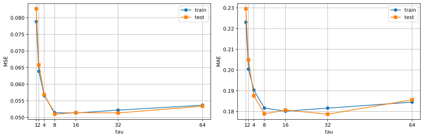
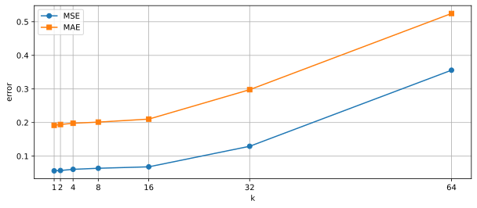
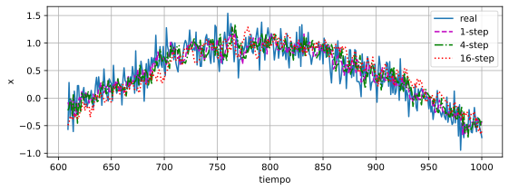
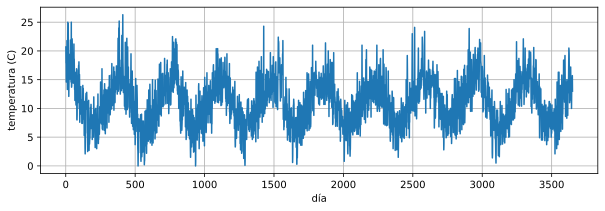
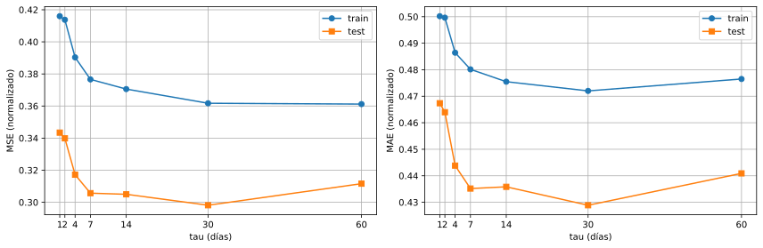
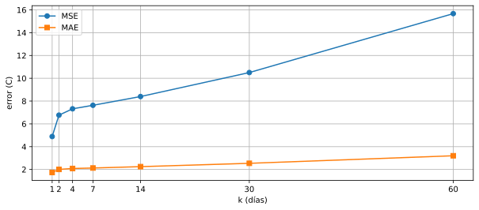
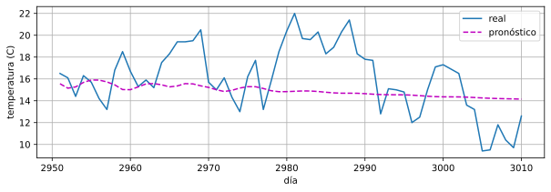

# P0 — Working with Sequences: experimentos y resultados

Este documento resume los experimentos realizados a partir del enunciado P0-Exercises, es decir, los ejercicios 1 a 4. El montaje común es una regresión lineal autorregresiva que predice $x_t$ a partir de las $\tau$ observaciones anteriores, $[x_{t-\tau},\dots,x_{t-1}]$, entrenada con `d2l.LinearRegression` (lr $=0.01$). La calidad se mide con MSE y MAE, principalmente sobre el tramo de test.

---

## Ejercicio 1. Influencia del número de observaciones pasadas ( $\tau$ )

**Diseño del experimento.** Serie $x_t=\sin(0.01t)+\varepsilon_t$ con $\varepsilon_t\sim\mathcal N(0,0.2^2)$, $T=1000$ y 600 puntos de entrenamiento. Se prueban $\tau\in\{1,2,4,8,16,32,64\}$ con 10 épocas y 3 semillas, promediando las métricas.

| $\tau$ | MSE train | MAE train | MSE test | MAE test | $\sigma$ MSE test | $\sigma$ MAE test |
|---:|---:|---:|---:|---:|---:|---:|
| 1  | 0.078851 | 0.223079 | 0.082695 | 0.229552 | 0.005807 | 0.007790 |
| 2  | 0.063879 | 0.200449 | 0.065785 | 0.204952 | 0.005483 | 0.009132 |
| 4  | 0.056605 | 0.190359 | 0.056915 | 0.187604 | 0.008900 | 0.012777 |
| **8**  | **0.051403** | **0.181631** | **0.050968** | **0.178892** | 0.004027 | 0.006351 |
| 16 | 0.051344 | 0.180169 | 0.051447 | 0.180678 | 0.004442 | 0.007065 |
| 32 | 0.052199 | 0.181618 | 0.051352 | 0.178683 | 0.004951 | 0.006196 |
| 64 | 0.053673 | 0.184523 | 0.053379 | 0.185643 | 0.001652 | 0.001353 |

Mejor $\tau$ por MSE de test: 8. Mejor por MAE de test: 32 (prácticamente empatado con 8).

**Conclusión.** El error cae al pasar de $\tau=1$ a $\tau=8$ y luego se estabiliza. Con $\tau$ pequeño el modelo solo ve un trozo de la dinámica sinusoidal; con $\tau$ grande se añaden parámetros y sensibilidad al ruido sin ganancia real. Se elige $\tau=8$ (MSE test $\approx0.051$, MAE test $\approx0.179$); $\tau=64$ empeora ligeramente.

---

## Ejercicio 2. Predicciones a $k$ pasos y error

**Diseño.** Se entrena el modelo final con $\tau=8$ y se generan predicciones recursivas a $k$ pasos: cada predicción se realimenta como entrada del siguiente paso. Se evalúan los mismos instantes de test para todos los horizontes, partiendo de las $\tau$ observaciones reales anteriores a cada origen.

| $k$ | $n_{test}$ | MSE | MAE |
|---:|---:|---:|---:|
| 1  | 392 | 0.056250 | 0.191739 |
| 2  | 392 | 0.057214 | 0.194159 |
| 4  | 392 | 0.060670 | 0.197849 |
| 8  | 392 | 0.063849 | 0.201319 |
| 16 | 392 | 0.068163 | 0.210226 |
| 32 | 392 | 0.129351 | 0.297833 |
| 64 | 392 | 0.355800 | 0.524607 |

**Conclusión.** El error crece con el horizonte: MSE de $0.056$ ( $k=1$ ) a $0.356$ ( $k=64$ ) y MAE de $\approx0.192$ a $\approx0.525$. El crecimiento es suave hasta $k\approx8$ y se acelera después por la acumulación de errores al realimentar las propias predicciones.

---

## Ejercicio 3. Análisis con datos reales

**Diseño.** Se usa `daily-min-temperatures.csv` (3650 días, 1981–1990) con split 80/20 (2920 train / 730 test). La temperatura se estandariza con la media y desviación del tramo de train; los errores se convierten de nuevo a °C. Se repite el barrido de $\tau\in\{1,2,4,7,14,30,60\}$ con 20 épocas y 3 semillas.

### 3.1. Selección de $\tau$

| $\tau$ (días) | MSE train | MAE train | MSE test | MAE test | $\sigma$ MSE test |
|---:|---:|---:|---:|---:|---:|
| 1  | 0.415988 | 0.500200 | 0.343415 | 0.467362 | 0.000904 |
| 2  | 0.413761 | 0.499648 | 0.339862 | 0.463974 | 0.000369 |
| 4  | 0.390326 | 0.486437 | 0.317193 | 0.443826 | 0.000560 |
| 7  | 0.376596 | 0.480142 | 0.305684 | 0.435177 | 0.001361 |
| 14 | 0.370557 | 0.475490 | 0.304983 | 0.435830 | 0.005095 |
| **30** | **0.361721** | **0.472018** | **0.298156** | **0.428878** | 0.001152 |
| 60 | 0.361204 | 0.476509 | 0.311605 | 0.440905 | 0.007065 |

Mejor $\tau$ por MSE y por MAE: 30 días (un mes).

**Conclusión.** El óptimo está en $\tau=30$ (MSE test $\approx0.298$ normalizado). Valores pequeños no capturan la persistencia ni la variación suave de la temperatura; 60 días añade parámetros y ruido.

### 3.2. Errores a distintos horizontes ( $\tau=30$ )

Modelo de un paso: MSE $=0.2966$ ( $4.891\ ^\circ\mathrm C^2$ ) y MAE $=0.4279$ ( $1.737\ ^\circ\mathrm C$ ).

| $k$ (días) | $n_{test}$ | MSE (norm.) | MAE (norm.) | MSE ($^\circ\mathrm C^2$) | MAE ($^\circ\mathrm C$) |
|---:|---:|---:|---:|---:|---:|
| 1  | 700 | 0.296624 | 0.427867 | 4.891 | 1.737 |
| 2  | 700 | 0.410384 | 0.494259 | 6.767 | 2.007 |
| 4  | 700 | 0.444058 | 0.513818 | 7.322 | 2.086 |
| 7  | 700 | 0.462789 | 0.524202 | 7.631 | 2.129 |
| 14 | 700 | 0.509363 | 0.553626 | 8.399 | 2.248 |
| 30 | 700 | 0.636991 | 0.625717 | 10.503 | 2.541 |
| 60 | 700 | 0.950477 | 0.788880 | 15.672 | 3.203 |

### 3.3. Pronóstico de 60 días

Partiendo del final del tramo de entrenamiento y realimentando el modelo de forma recursiva:

- MSE $=9.572\ ^\circ\mathrm C^2$
- MAE $=2.518\ ^\circ\mathrm C$

**Conclusiones del ejercicio 3.** El modelo aprende bien la persistencia a corto plazo: MAE $\approx1.74\ ^\circ\mathrm C$ a un día, alrededor de $2.0\ ^\circ\mathrm C$ a 2 días y más de $3.2\ ^\circ\mathrm C$ a 60 días. Al realimentar las predicciones el error se acumula y el modelo tiende a la media, por lo que no reproduce la estacionalidad anual.

---

## Ejercicio 4. Teoría: autorregresivos frente a autorregresivos latentes

Un **modelo autorregresivo (AR)** explica el valor actual a partir de valores pasados observados:

$$x_t = f(x_{t-1}, x_{t-2}, \ldots, x_{t-\tau}) + \varepsilon_t.$$

La dinámica se supone contenida en las observaciones pasadas; es el supuesto del modelo lineal de esta práctica.

Un **modelo autorregresivo latente** introduce una variable de estado no observada $z_t$ que evoluciona de forma autorregresiva y genera las observaciones:

$$z_t = g(z_{t-1}) + \eta_t, \qquad x_t = h(z_t) + \varepsilon_t.$$

La dependencia temporal pasa por el estado latente. Ejemplos: espacio de estados/Kalman, HMM y DeepAR (red recurrente con estado interno).

**Casos que requieren variables latentes:**

- **Cambios de régimen no observados.** En finanzas la volatilidad no se observa y un AR sobre precios no anticipa bien los cambios de calma a alta volatilidad; un HMM o un modelo de volatilidad estocástica introduce un régimen latente. Algo similar ocurre con frentes meteorológicos no observados en la temperatura.
- **Observaciones faltantes o ruido de medida.** Un AR se queda sin entradas, mientras que un modelo de espacio de estados sigue actualizando su estado. Ejemplo: el GPS en un túnel; con velocidad y dirección latentes se puede seguir estimando la posición.

---

## Conclusiones generales

- **Serie sintética:** con $\tau=8$, MSE de test $\approx0.051$ y MAE $\approx0.179$; el error a $k$ pasos crece de $0.056$ ( $k=1$ ) a $0.356$ ( $k=64$ ) por la acumulación de errores.
- **Temperatura:** el óptimo es $\tau=30$ (MSE de test $\approx0.298$); el MAE pasa de $\approx1.74\ ^\circ\mathrm C$ a 1 paso a $\approx3.20\ ^\circ\mathrm C$ a 60 días. Captura la persistencia diaria, no la estacionalidad anual.
- **AR frente a AR latente:** el AR solo usa observaciones pasadas; si la dinámica depende de estados no observados (volatilidad, regímenes, GPS en un túnel), se necesita un estado latente (Kalman, HMM, DeepAR).
- **Mejoras:** el modelo lineal es una buena base, pero no captura no linealidades ni estacionalidad; conviene añadir variables exógenas (por ejemplo, la estación) o usar modelos con estado latente.
