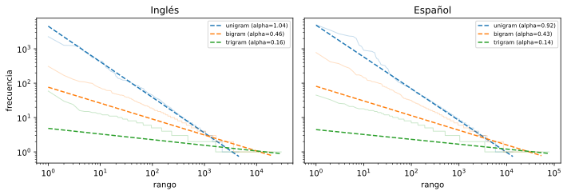
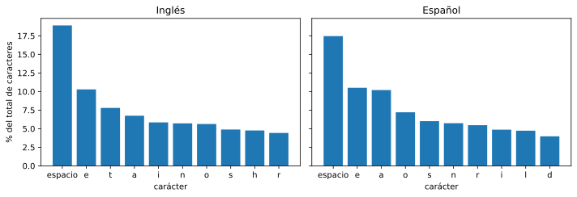

# P1 — Converting Raw Text into Sequence Data: experimentos y resultados

Este documento resume la resolución de los ejercicios 2 a 4 del notebook `L1NB.ipynb`:

1. ajuste de la ley de Zipf para unigramas, bigramas y trigramas en inglés;
2. repetición del análisis sobre el corpus español *Juvenilia*;
3. comparación entre ambos idiomas y conclusiones.

Todos los resultados proceden de las celdas de resolución del notebook. El preprocesado elimina puntuación y pasa el texto a minúsculas; en español se conservan las letras acentuadas y la ñ. Los $n$-gramas se construyen uniendo palabras con `--`, y el ajuste de Zipf se obtiene por mínimos cuadrados sobre

$$\log n_i = -\alpha \log i + c,$$

de modo que $\alpha$ es el valor absoluto de la pendiente. La bondad del ajuste se mide con $R^2$ y con el MSE en escala logarítmica.

---

## Ejercicio 2. Ajuste lineal de la ley de Zipf (inglés)

Corpus: *The Time Machine* de H. G. Wells, con 32 775 palabras y 4 579 palabras distintas.

| $n$-grama | $\alpha$ | $R^2$ | MSE (log) | Tokens únicos |
|---|---:|---:|---:|---:|
| unigrama | 1.0353 | 0.9717 | 0.0310 | 4 579 |
| bigrama | 0.4637 | 0.8101 | 0.0503 | 20 234 |
| trigrama | 0.1642 | 0.5289 | 0.0240 | 29 882 |

El unigrama se ajusta muy bien y su exponente queda próximo al valor teórico $\alpha\approx1$. Los bigramas y trigramas presentan exponentes progresivamente menores y un ajuste relativo peor: las combinaciones son cada vez más específicas, muchas aparecen una sola vez y la cola de la distribución es más ruidosa.

### Palabras más frecuentes (inglés)

| # | Palabra | Frecuencia |
|---:|---|---:|
| 1 | the | 2 261 |
| 2 | i | 1 267 |
| 3 | and | 1 245 |
| 4 | of | 1 155 |
| 5 | a | 816 |
| 6 | to | 695 |
| 7 | was | 552 |
| 8 | in | 541 |
| 9 | that | 443 |
| 10 | my | 440 |

### Caracteres más frecuentes (inglés)

| # | Carácter | Frecuencia |
|---:|---|---:|
| 1 | espacio | 32 775 |
| 2 | e | 17 838 |
| 3 | t | 13 515 |
| 4 | a | 11 704 |
| 5 | i | 10 138 |
| 6 | n | 9 917 |
| 7 | o | 9 758 |
| 8 | s | 8 486 |
| 9 | h | 8 257 |
| 10 | r | 7 674 |

Dominan artículos, pronombres y preposiciones (*the, i, and, of, a*). En cuanto a caracteres, tras el espacio aparecen *e, t, a, i, n*, coherente con la ortografía inglesa.

---

## Ejercicio 3. Repetición del análisis con *Juvenilia* (español)

Corpus: *Juvenilia*, de Miguel Cané, con 84 269 palabras y 13 547 palabras distintas.

| $n$-grama | $\alpha$ | $R^2$ | MSE (log) | Tokens únicos |
|---|---:|---:|---:|---:|
| unigrama | 0.9250 | 0.9618 | 0.0338 | 13 547 |
| bigrama | 0.4267 | 0.7826 | 0.0505 | 53 916 |
| trigrama | 0.1418 | 0.4825 | 0.0215 | 78 165 |

Se repite el mismo patrón que en inglés: el unigrama sigue una ley de Zipf clara, mientras que los $n$-gramas mayores tienen exponentes menores y peor $R^2$.

### Palabras más frecuentes (español)

| # | Palabra | Frecuencia |
|---:|---|---:|
| 1 | de | 5 010 |
| 2 | la | 3 479 |
| 3 | que | 2 747 |
| 4 | el | 2 518 |
| 5 | y | 2 349 |
| 6 | en | 2 301 |
| 7 | a | 1 996 |
| 8 | los | 1 287 |
| 9 | un | 1 179 |
| 10 | su | 907 |

### Caracteres más frecuentes (español)

| # | Carácter | Frecuencia |
|---:|---|---:|
| 1 | espacio | 84 270 |
| 2 | e | 50 704 |
| 3 | a | 49 262 |
| 4 | o | 34 801 |
| 5 | s | 29 038 |
| 6 | n | 27 690 |
| 7 | r | 26 407 |
| 8 | i | 23 498 |
| 9 | l | 22 825 |
| 10 | d | 19 167 |

Las palabras más frecuentes vuelven a ser funcionales (*de, la, que, el, y, en*). En caracteres, tras el espacio destacan *e, a, o, s, n*, también coherente con la ortografía española.

---

## Ejercicio 4. Comparación y conclusiones

### Exponentes y bondad del ajuste

| $n$-grama | $\alpha$ inglés | $R^2$ inglés | $\alpha$ español | $R^2$ español |
|---|---:|---:|---:|---:|
| unigrama | 1.0353 | 0.9717 | 0.9250 | 0.9618 |
| bigrama | 0.4637 | 0.8101 | 0.4267 | 0.7826 |
| trigrama | 0.1642 | 0.5289 | 0.1418 | 0.4825 |

En ambos idiomas los unigramas se acercan a $\alpha\approx1$ (1.035 en inglés y 0.925 en español). Los bigramas y trigramas tienen exponentes mucho menores (0.46/0.16 en inglés y 0.43/0.14 en español) porque las secuencias largas son más específicas y muchas solo aparecen una vez. El $R^2$ es alto para unigramas (0.972 y 0.962) y desciende para bigramas y trigramas (0.810/0.529 y 0.783/0.483).

### Curvas de frecuencia y rectas ajustadas

Curvas empíricas (trazo claro) y rectas de Zipf ajustadas (trazo discontinuo) para unigramas, bigramas y trigramas en cada idioma:

### Frecuencia relativa de caracteres

Frecuencia relativa de los diez caracteres más comunes en cada idioma (el espacio se etiqueta como «espacio»):

### Conclusiones

- **Palabras más frecuentes:** en inglés dominan *the, i, and, of, a*; en español, *de, la, que, el, y*. En ambos casos son palabras funcionales que aparecen continuamente para dar estructura gramatical y por eso encabezan el ranking.
- **Caracteres:** el espacio es el más frecuente en los dos textos. Después aparecen *e, t, a* en inglés y *e, a, o* en español, en línea con las frecuencias típicas de cada idioma.
- **Exponentes de Zipf:** los unigramas se acercan a $\alpha\approx1$ (1.035 en inglés y 0.925 en español). Bigramas y trigramas tienen exponentes mucho menores (0.46/0.16 y 0.43/0.14), porque las secuencias largas son más específicas y muchas solo aparecen una vez.
- **Bondad del ajuste:** $R^2$ es alto para unigramas (0.972 y 0.962) y desciende para bigramas y trigramas (0.810/0.529 y 0.783/0.483). El MSE logarítmico es pequeño, pero el ajuste relativo empeora al aumentar $n$ por la dispersión de la cola.
- **Comparación con la literatura:** los corpus grandes de inglés suelen dar $\alpha\approx1.0$–$1.1$ y los de español valores cercanos a $0.9$–$1.0$, coherentes con lo obtenido. Las diferencias se explican por el tamaño limitado de estos corpus y por el preprocesado, pero en ambos idiomas se confirma el comportamiento de la ley de Zipf.
