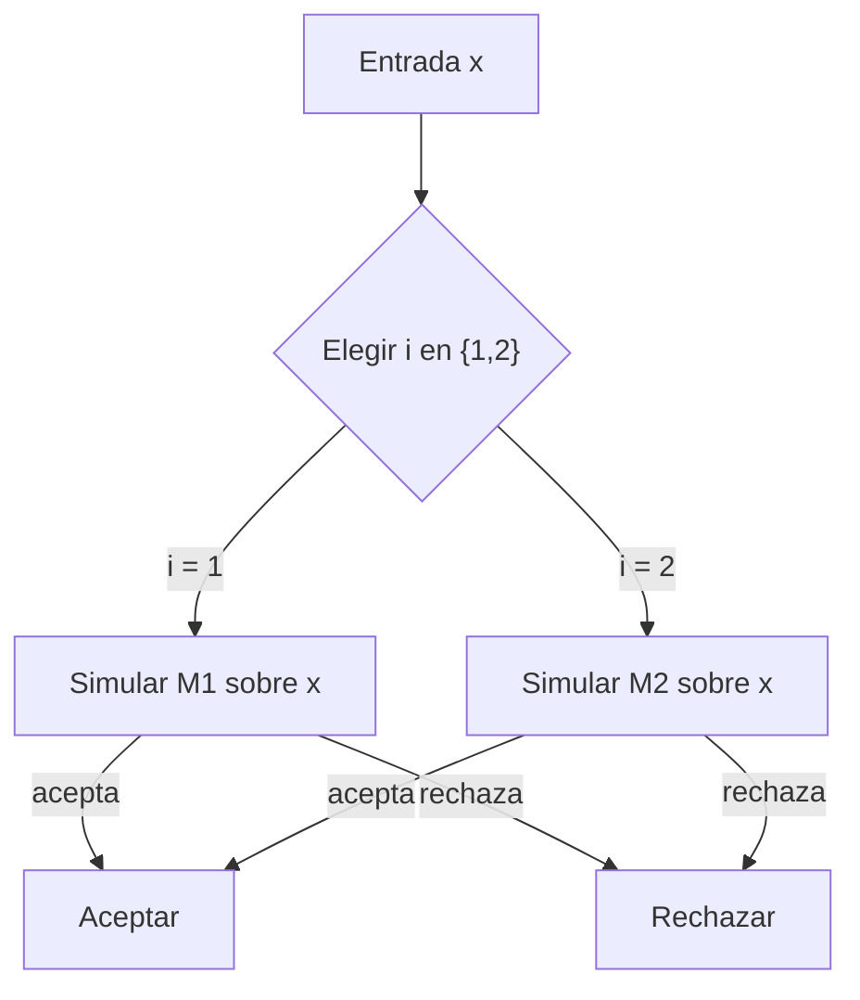
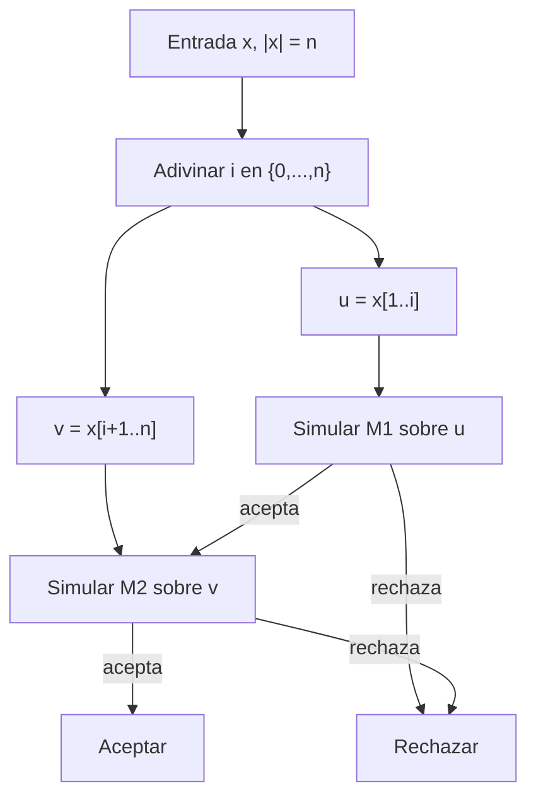

# Cierre de NP bajo unión y concatenación

## 1. Introducción

### 1.1. Enunciado

Se pide demostrar que la clase **NP** es cerrada bajo las operaciones de **unión** y **concatenación**. Es decir, si $L_1,L_2\in\mathrm{NP}$, entonces

$$
L_1\cup L_2\in\mathrm{NP}
\qquad\text{y}\qquad
L_1L_2\in\mathrm{NP},
$$

donde

$$
L_1\cup L_2=\{x\mid x\in L_1\ \text{o}\ x\in L_2\}
$$

y

$$
L_1L_2=\{x\mid \exists u,v\in\Sigma^*:\ x=uv,\ u\in L_1,\ v\in L_2\}.
$$

### 1.2. Recordatorio de NP

Un lenguaje $L$ está en **NP** si existe una máquina de Turing no determinista (MTN) $M$ que lo decide en tiempo polinómico: existe un polinomio $p$ tal que, para toda entrada $x$, todas las computaciones de $M$ sobre $x$ se detienen en a lo sumo $p(|x|)$ pasos, y $M$ acepta $x$ si y solo si $x\in L$.

Equivalentemente, $L\in\mathrm{NP}$ si existe un **verificador** determinista $V$ que trabaja en tiempo polinómico y un polinomio $p$ tales que

$$
x\in L
\iff
\exists c\in\Sigma^*:\ |c|\le p(|x|)\ \text{y}\ V(x,c)=1.
$$

La cadena $c$ se llama **certificado** o **testigo**. Esta segunda caracterización será muy útil: en NP, la pertenencia se expresa mediante una **existencia** de un testigo de tamaño polinómico.

### 1.3. Aclaraciones y ejemplos

- NP es una clase de **lenguajes**, no de algoritmos concretos. Decir que es cerrada bajo una operación significa que podemos construir un nuevo lenguaje en NP a partir de lenguajes que ya están en NP.
- En la unión, basta con que se cumpla una de las dos condiciones. En términos de testigos, es una especie de **OR** existencial.
- En la concatenación, la dificultad añadida es que hay que **adivinar dónde termina la primera palabra y dónde empieza la segunda**. El corte no viene dado en la entrada.
- Ejemplo intuitivo de unión: si $L_1$ es el lenguaje de las fórmulas booleanas satisfacibles (SAT) y $L_2$ es el lenguaje de las instancias de CLIQUE, una entrada de $L_1\cup L_2$ puede ser una fórmula satisfacible o un grafo con un clique del tamaño pedido; la máquina no determinista puede elegir qué caso comprobar.
- Ejemplo intuitivo de concatenación: una cadena de $L_1L_2$ es la concatenación de una instancia de $L_1$ y otra de $L_2$. La máquina debe descubrir el punto de corte y verificar ambas partes.

---

## 2. Resolución del ejercicio

### 2.1. Idea común

La idea central es que NP captura problemas con **certificados polinómicos**. Para demostrar el cierre, debemos construir un nuevo certificado o una nueva MTN polinómica que combine los certificados o las máquinas de $L_1$ y $L_2$ sin salirse del tiempo polinómico.

- En la **unión**, el nuevo certificado indica cuál de los dos lenguajes se está usando y contiene el certificado correspondiente.
- En la **concatenación**, el nuevo certificado contiene el **punto de corte** y los certificados de las dos partes.

El punto delicado es garantizar que el tamaño total del nuevo certificado y el tiempo de verificación sigan siendo polinómicos en $|x|$.

### 2.2. NP es cerrado bajo unión

**Teorema 1.** Si $L_1,L_2\in\mathrm{NP}$, entonces $L_1\cup L_2\in\mathrm{NP}$.

#### Demostración con máquinas de Turing no deterministas

Sean $M_1$ y $M_2$ MTN que deciden $L_1$ y $L_2$ en tiempo acotado por los polinomios $p_1$ y $p_2$, respectivamente.

Construimos una MTN $M_\cup$ que, sobre una entrada $x$ de longitud $n$, hace lo siguiente:

1. Elige de forma no determinista un índice $i\in\{1,2\}$.
2. Si $i=1$, simula $M_1$ sobre $x$; si $i=2$, simula $M_2$ sobre $x$.
3. Acepta si la máquina simulada acepta; en caso contrario, rechaza.

**Correctitud.**

- Si $x\in L_1\cup L_2$, entonces $x\in L_1$ o $x\in L_2$. Si $x\in L_1$, la máquina $M_1$ tiene alguna rama aceptadora sobre $x$; la rama de $M_\cup$ que elige $i=1$ y sigue esa rama acepta. Análogamente, si $x\in L_2$, la rama que elige $i=2$ acepta.
- Si $M_\cup$ acepta $x$, entonces eligió algún $i\in\{1,2\}$ y la máquina $M_i$ aceptó $x$. Por tanto, $x\in L_i$, luego $x\in L_1\cup L_2$.
- Si $x\notin L_1\cup L_2$, entonces $x\notin L_1$ y $x\notin L_2$; ninguna rama de $M_1$ ni de $M_2$ acepta, así que ninguna rama de $M_\cup$ acepta.

Por tanto, $L(M_\cup)=L_1\cup L_2$.

**Complejidad.** Para cualquier rama, el coste es el de elegir un índice, $O(1)$, más el de simular $M_1$ o $M_2$:

$$
O(1)+\max\{p_1(n),p_2(n)\}=O(p_1(n)+p_2(n)).
$$

La suma de dos polinomios es un polinomio, así que $M_\cup$ decide $L_1\cup L_2$ en tiempo polinómico. Por tanto, $L_1\cup L_2\in\mathrm{NP}$.

> **Cuidado:** no se debe intentar implementar la unión ejecutando $M_1$ y, “si rechaza”, ejecutando $M_2$ sobre la misma rama. En una MTN, que una rama rechace no significa que todas las ramas de $M_1$ rechacen. La construcción correcta elige no determinísticamente una de las dos máquinas.

#### Versión con verificadores

Sean $V_1$ y $V_2$ verificadores polinómicos para $L_1$ y $L_2$, con cotas $p_1$ y $p_2$ para el tamaño de los certificados.

Definimos un verificador $V_\cup$ para $L_1\cup L_2$ que, dado $(x,c)$, interpreta el certificado como un par $(i,c_i)$ con $i\in\{1,2\}$ y comprueba:

- si $i=1$, acepta si y solo si $V_1(x,c_1)=1$;
- si $i=2$, acepta si y solo si $V_2(x,c_2)=1$;
- en cualquier otro caso, rechaza.

El certificado tiene tamaño a lo sumo

$$
1+\max\{p_1(n),p_2(n)\},
$$

que es polinómico en $n=|x|$. El tiempo de verificación también es polinómico. Además:

- si $x\in L_1\cup L_2$, basta elegir el índice del lenguaje al que pertenece $x$ y su certificado;
- si $x\notin L_1\cup L_2$, ningún índice ni certificado puede hacer que $V_\cup$ acepte.

Por tanto, $L_1\cup L_2\in\mathrm{NP}$.

### 2.3. NP es cerrado bajo concatenación

**Teorema 2.** Si $L_1,L_2\in\mathrm{NP}$, entonces $L_1L_2\in\mathrm{NP}$.

#### Demostración con máquinas de Turing no deterministas

Sean $M_1$ y $M_2$ MTN que deciden $L_1$ y $L_2$ en tiempo acotado por $p_1$ y $p_2$, respectivamente.

Construimos una MTN $M_\cdot$ que, sobre una entrada $x$ de longitud $n$, hace lo siguiente:

1. Elige de forma no determinista un punto de corte $i\in\{0,1,\dots,n\}$.
2. Sea $u=x[1\ldots i]$ el prefijo de longitud $i$ y $v=x[i+1\ldots n]$ el sufijo restante.
3. Simula $M_1$ sobre $u$. Las ramas que rechazan se rechazan; las que aceptan continúan.
4. Sobre cada rama que ha aceptado $u$, simula $M_2$ sobre $v$.
5. Acepta si $M_2$ acepta $v$; en caso contrario, rechaza.

Para que la simulación sea válida, el prefijo $u$ se copia a una cinta de trabajo o se delimita mediante marcadores, de modo que $M_1$ no pueda leer el sufijo $v$. Lo mismo se hace con $v$ al simular $M_2$. Este copiado o marcado consume tiempo $O(n)$, que sigue siendo polinómico. También podemos suponer que las máquinas son multicinta, pues el modelo multicinta y el unicinta son equivalentes con un coste polinómico.

**Correctitud.**

- Si $x\in L_1L_2$, existen $u,v$ con $x=uv$, $u\in L_1$ y $v\in L_2$. Sea $i=|u|$. La máquina $M_1$ tiene una rama aceptadora sobre $u$ y $M_2$ tiene una rama aceptadora sobre $v$. La máquina $M_\cdot$ puede adivinar exactamente ese corte $i$, seguir la rama aceptadora de $M_1$ y después la de $M_2$, y aceptar.
- Si $M_\cdot$ acepta $x$, entonces adivinó algún corte $i$ para el cual $M_1$ aceptó $u=x[1\ldots i]$ y $M_2$ aceptó $v=x[i+1\ldots n]$. Por tanto, $u\in L_1$, $v\in L_2$ y $x=uv$, luego $x\in L_1L_2$.

Así, $L(M_\cdot)=L_1L_2$.

**Complejidad.** Adivinar el corte cuesta $O(n)$ pasos (o $O(\log n)$ si se escribe el índice en binario). Para un corte fijo $i$, la simulación de $M_1$ tarda como máximo $p_1(i)$ pasos y la de $M_2$ como máximo $p_2(n-i)$ pasos. Por tanto, toda rama se detiene en

$$
O(n)+p_1(i)+p_2(n-i)
\le
O(n)+p_1(n)+p_2(n),
$$

que es una cantidad polinómica en $n$. En consecuencia, $M_\cdot$ decide $L_1L_2$ en tiempo polinómico y $L_1L_2\in\mathrm{NP}$.

> **Cuidado:** no basta con ejecutar $M_1$ sobre toda la entrada y luego $M_2$ sobre toda la entrada. La concatenación exige que la misma cadena se divida en dos partes, y ese punto de corte es precisamente lo que se adivina.

#### Versión con verificadores

Sean $V_1$ y $V_2$ verificadores polinómicos para $L_1$ y $L_2$, con cotas $p_1$ y $p_2$ para sus certificados.

Definimos un verificador $V_\cdot$ para $L_1L_2$. Un certificado es una terna

$$
(i,c_1,c_2),
$$

donde $i\in\{0,1,\dots,n\}$ es el punto de corte, $c_1$ es un certificado para el prefijo y $c_2$ es un certificado para el sufijo. Sobre una entrada $x$ de longitud $n$, $V_\cdot$ hace:

1. Comprueba que $0\le i\le n$.
2. Calcula $u=x[1\ldots i]$ y $v=x[i+1\ldots n]$.
3. Acepta si y solo si $V_1(u,c_1)=1$ y $V_2(v,c_2)=1$.

El tamaño del certificado es

$$
O(\log n)+p_1(i)+p_2(n-i)
\le
O(\log n)+p_1(n)+p_2(n),
$$

que es polinómico en $n$. El tiempo de verificación es $O(n)+p_1(n)+p_2(n)$, también polinómico.

La correctitud es inmediata:

- si $x\in L_1L_2$, existen un corte $i$ y certificados $c_1,c_2$ que hacen aceptar a $V_1$ y $V_2$;
- si $V_\cdot$ acepta con algún certificado, entonces el prefijo está en $L_1$ y el sufijo está en $L_2$, luego $x\in L_1L_2$.

Por tanto, $L_1L_2\in\mathrm{NP}$.

#### Ejemplo de la no unicidad del corte

Consideremos los lenguajes finitos $L_1=\{a,ab\}$ y $L_2=\{b,bb\}$. La cadena $abb$ pertenece a $L_1L_2$ y admite dos cortes válidos:

$$
a\mid bb
\qquad\text{y}\qquad
ab\mid b.
$$

Una MTN no necesita conocer el corte de antemano: le basta con adivinar uno correcto. Esta es la esencia de la construcción anterior. En un caso real, $L_1$ y $L_2$ podrían ser, por ejemplo, SAT y CLIQUE; entonces el certificado incluiría el corte y los testigos de satisfacibilidad y de clique.

### 2.4. Resumen

| Operación | Qué se adivina | Certificado | Tiempo |
|---|---|---|---|
| $L_1\cup L_2$ | Índice $i\in\{1,2\}$ | $(i,c_i)$ | $O(p_1(n)+p_2(n))$ |
| $L_1L_2$ | Corte $i\in\{0,\dots,n\}$ | $(i,c_1,c_2)$ | $O(n+p_1(n)+p_2(n))$ |

En ambos casos, el certificado y la verificación son polinómicos, luego el lenguaje resultante está en NP.

---

## 3. Contextualización más allá del ejercicio

El resultado no es una curiosidad aislada: las **propiedades de cierre** permiten tratar las clases de complejidad como un álgebra de lenguajes. Gracias a ellas podemos construir lenguajes nuevos a partir de lenguajes conocidos sin volver a describir máquinas desde cero. En el caso de NP, la clave es que el nuevo certificado sigue siendo una única existencia de tamaño polinómico.

Desde el punto de vista lógico, NP se corresponde con las propiedades expresables mediante un **cuantificador existencial** sobre un testigo polinómico. La unión y la concatenación conservan ese cuantificador existencial: en la unión se elige una de las dos alternativas y en la concatenación se elige un corte junto con dos testigos. La intersección también se puede expresar en NP: basta con exigir dos testigos, uno para cada lenguaje. En cambio, el **complemento** exigiría en principio un cuantificador universal (“para todo certificado, no se cumple”), lo que conduce a la clase **coNP**. De hecho, no se sabe si NP es cerrada bajo complemento; ello equivaldría a demostrar $\mathrm{NP}=\mathrm{coNP}$, uno de los grandes problemas abiertos de la teoría de la complejidad.

También conviene comparar con clases más sencillas. Los lenguajes regulares y los lenguajes libres de contexto son cerrados bajo unión y concatenación, y **P** es cerrado bajo unión, intersección, concatenación y complemento. NP comparte varias de estas propiedades, pero no se conoce el cierre bajo complemento. Esta asimetría refleja que en NP los testigos son existenciales: es fácil combinar dos posibilidades o dos partes de una solución, pero no es evidente cómo expresar la ausencia de toda solución.

Finalmente, estas operaciones aparecen con frecuencia en reducciones y en el diseño de algoritmos. Si un problema se puede descomponer en dos subproblemas NP con un punto de corte que se puede adivinar, entonces el problema completo está en NP. Reconocer esta estructura ayuda a clasificar problemas y a construir reducciones sin tener que diseñar una máquina de Turing explícita. El teorema de Cook-Levin, que establece que SAT es NP-completo, es el ejemplo paradigmático de cómo una caracterización local y verificable conduce a una clase robusta y cerrada bajo operaciones naturales.

---

## 4. Referencias

1. Sipser, M. (2013). *Introduction to the Theory of Computation* (3rd ed.). Cengage Learning. Capítulo 7, “Time Complexity”, y en particular las secciones sobre las clases P y NP.
2. Arora, S., & Barak, B. (2009). *Computational Complexity: A Modern Approach*. Cambridge University Press. Capítulo 2, “NP and NP Completeness”.
3. Papadimitriou, C. H. (1994). *Computational Complexity*. Addison-Wesley. Capítulo 2, “P and NP”.
4. Apuntes de la asignatura *Algoritmia y Complejidad* (AYC), Universidad de Málaga, curso 2026-2027. Definiciones de NP, máquinas de Turing no deterministas y verificadores polinómicos.
