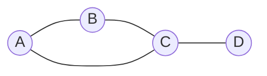

## Introducción
En teoría de grafos y complejidad computacional, un triángulo en un grafo no dirigido $G = (V, E)$ es un 3-clique. Formalmente, un subconjunto de tres vértices distintos $\{u, v, w\} \subseteq V$ forma un triángulo si existen entre ellos las tres aristas posibles: $$\{(u, v), (v, w), (w, u)\} \subseteq E$$

El problema de decisión $TRIANGLE$ se define como: $$TRIANGLE = \{ \langle G \rangle \mid G \text{ es un grafo no dirigido que contiene al menos un triángulo} \}$$
Para demostrar que $TRIANGLE \in P$, lo que implica construir un algoritmo determinista (o Máquina de Turing Determinista, MTD) que decida si un grafo $G$ contiene un triángulo en tiempo polinómico con respecto al tamaño de la entrada $\langle G \rangle$.

**Ejemplo:** sea $G_1 = (V_1, E_1)$ con $V_1 = \{A, B, C, D\}$ y $E_1 = \{(A,B), (B,C), (C,A), (C,D)\}$. El conjunto de vértices $\{A, B, C\}$ posee las aristas $(A,B), (B,C), (C,A) \in E_1$, por lo que $G_1$ contiene un triángulo, $G_1 \in TRIANGLE$.

## Demostración mediante Máquinas de Turing Deterministas (mTD)
- **Hipótesis:** sea $M$ una mTD que decide $TRIANGLE$ en tiempo polinómico.
- **Construcción de la mTD:** sea la codificación $\langle G \rangle$ de un grafo no dirigido $G = (V, E)$ con $n = |V|$ vértices y $m = |E|$ aristas:
	1. Verificar que $\langle G \rangle$ es una codificación válida de un grafo no dirigido. Si la codificación no es válida, rechazar.
	2. Para cada conjunto no ordenado de 3 vértices distintos $\{u, v, w\} \subseteq V$:
	    - Consultar en la estructura del grafo si $(u, v) \in E$, $(v, w) \in E$ y $(w, u) \in E$.
	    - Si las tres aristas existen en $E$, aceptar.
	3. Si se han examinado todos los $\binom{n}{3}$ tríos de vértices posibles sin encontrar ningún triángulo, rechazar.
- **Correctitud:**
	- Si $\langle G \rangle \in TRIANGLE$, entonces existe al menos un trío de vértices $\{u, v, w\} \subseteq V$ mutuamente conectados. En la etapa 2, la MTD $M$ evaluará exhaustivamente dicho trío, verificará la presencia de sus 3 aristas y aceptará.
	- Si $\langle G \rangle \notin TRIANGLE$, no existe ningún trío en $V$ que posea las 3 aristas de interconexión. La etapa 2 examinará todos los tríos sin activar la condición de aceptación y la MTD terminará en la etapa 3 rechazando la cadena.
- **Análisis de Complejidad Temporal:** asumiendo una representación como matriz de adyacencia de $n \times n$:
	1. Comprobar que la representación del grafo es correcta toma tiempo $O(n^2)$.
	2. El número de tríos de vértices a evaluar viene dado por el coeficiente binomial: $$\binom{n}{3} = \frac{n(n-1)(n-2)}{6} = O(n^3)$$
	3. Para cada trío se realizan tres consultas de aristas, cada una en tiempo $O(1)$; por tanto, el bucle completo cuesta $O(n^3)$.
	4. Si se agotan los tríos sin encontrar un triángulo, se rechaza; esta comprobación final es $O(1)$.

Como la máquina está acotada por un polinomio respecto a la entrada ($O(n^3)$), entonces $TRIANGLE \in P$

## Contextualización más allá del ejercicio
### Relación entre $k$-CLIQUE constante y $k$-CLIQUE general
- $k$**-CLIQUE con** $k$ **constante (**$k=3$**):** cuando el tamaño del subgrafo completo $k$ es un parámetro fijo y constante, el problema pertenece a la clase P, ya que el espacio de búsqueda de combinaciones $\binom{n}{k} = O(n^k)$ es de orden polinómico (un polinomio de grado $k$).
- $CLIQUE$ **general (parámetro** $k$ **como parte de la entrada):** Cuando $k$ no es fijo, el problema $CLIQUE = \{ \langle G, k \rangle \mid G \text{ tiene un } k\text{-clique} \}$ pasa a ser NP-completo. En el peor caso (por ejemplo $k = n/2$), el número de combinaciones a verificar $\binom{n}{n/2} \approx \frac{2^n}{\sqrt{n}}$ crece exponencialmente, imposibilitando la resolución determinista exhaustiva en tiempo polinómico a menos que P = NP.

### Algoritmos avanzados mediante multiplicación de matrices
Aunque el enfoque por fuerza bruta presentado logra una complejidad de $O(n^3)$, el problema $TRIANGLE$ admite algoritmos deterministas significativamente más eficientes mediante álgebra lineal:
- Si $A$ es la matriz de adyacencia de $G$, el elemento $(A^3)_{i,i}$ en la diagonal de la matriz $A^3$ contabiliza el número de caminos cerrados de longitud 3 que empiezan y terminan en el vértice $i$.
- El número total de triángulos en el grafo es igual a: $$\text{Número de triángulos} = \frac{\text{Tr}(A^3)}{6}$$
- Empleando algoritmos rápidos de multiplicación de matrices (como el algoritmo de Strassen o avances recientes), la matriz $A^3$ se puede calcular en tiempo $O(n^{\omega})$, donde $\omega \approx 2.373$. Esto sitúa a $TRIANGLE$ en una clase de complejidad temporal aún más restringida dentro de P.

## Referencias
- **Complejidad en Tiempo: Clase P** (`07-Complejidad Tiempo--P.pdf`): Clase P, representaciones polinómicas de grafos y algoritmos deterministas.
- **Complejidad en Tiempo: Clase NP** (`08-Complejidad Tiempo--NP.pdf`): Definición formal de cliques y clases de complejidad.
- **Complejidad en Tiempo: NPC - Ejemplos** (`10-Complejidad Tiempo--NPC_ejemplos.pdf`): Metodología de análisis de bloques y reducción polinómica.

### Uso de IA Generativa
1. **Herramienta utilizada**: Gemini Notebook 
2. **Propósito del uso**: 
	- Asistencia en la resolución formal y estructuración adaptándolo estrictamente a los apartados de la rúbrica solicitada.
3. **Prompts o instrucciones proporcionadas**: 
	- "Triangle se puede resolver de forma bruta comparando para cada tres aristas comprobar que están conectadas no? si se puede hacer así ya se demuestra que está en P no?"
	- "Añade alguna reflexión adicional sobre el problema, conectándolo con conceptos conocidos o próximos a los conocidos"
4. **Uso del contenido generado**: a diferencia del otro ejercicio, tenía ya alguna idea de demostración (evaluación por fuerza bruta). El objetivo del uso de la IA fue obtener la formalización matemática adecuada (especificación de la MTD, análisis por bloques y complejidad).
5. **Revisión y edición**: partiendo del conocimiento del funcionamiento de la demostración, revisé y verifiqué la corrección técnica de todo el desarrollo generado antes de su inclusión final.